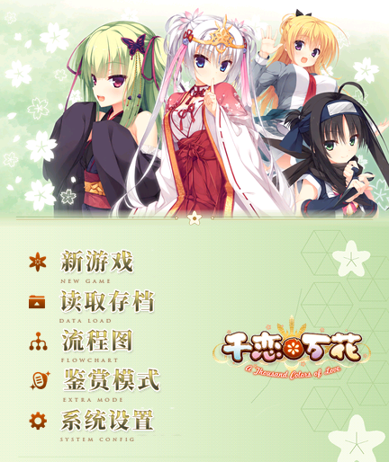
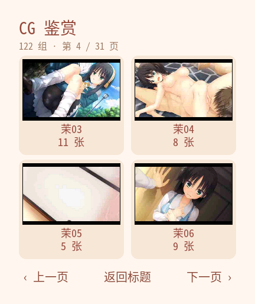
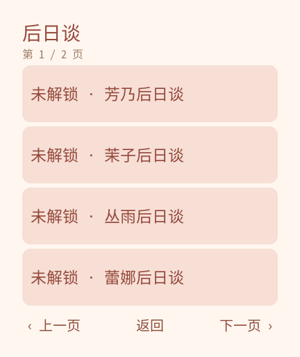

# 《千恋＊万花》· REDMI Watch 5 完整版

当前版本 **0.1.13 / versionCode 14**，屏幕 432×514，包名 `com.codex.senren.rw5`。安装包 **24,207,073 字节（24.21 MB）**，解压后 39,890,605 字节。

正篇内容取自原作**完整版**脚本与全部 CG：92 个剧情脚本、869 个控制节点、55,726 条中文文本、97 个选项、7 个结局。原著 UI 与阅读框架为本项目自行实现。

## 功能

- **正文**：点击推进、拖动浏览；未显示完时点击补全当前句，再点进入下一句。
- **显示**：标准 24 px / 大字号 28 px；即时与逐字两档；正文宽度 368，左右 32、顶部 26、底部 24 安全区。
- **自动播放**：慢速 2.6 秒、标准 1.5 秒、快速 0.8 秒（逐字完成后等待）；遇选项、菜单、后台自动暂停，点“上一句”关闭自动。
- **存档**：30 个栏位，覆盖前确认；存档格式 `format:1`，旧版节点 id 全部保留，只有 `113` 的一处场景改由 `graph.migrations` 转指。
- **流程图**：路线 → 章节二级目录，可直接跳到任一章；章节预览不写通关标记。
- **图库**：122 组 / 1,479 张，分组顺序与组名（芳01…芦03…）与原作 CG 模式清单一致，组内点击切换差分。
- **后日谈**：流程图新增“后日谈”入口，6 个追加章节（芳乃／茉子／丛雨／蕾娜／小春／芦花），通过对应角色线后解锁，未解锁会提示所需路线，已解锁可直接进入。
- **OP**：108 秒、648 张独立帧、6 fps、固定位置播放，可跳过，也可在 EXTRA 重看。
- **音乐**：标题曲与 OP 音轨，统一声音开关只影响本应用，不写系统音量。
- 没有语音、结局影片与复杂动态演出，属图文阅读应用。

## 体积与适配

本版把可用图像从 1,026 张增加到 1,773 张，为把包体压到 25,000,000 字节以内做了三处有损取舍：剧情／背景 JPEG 质量 22、表情图集 200 色、标题曲 32 kb/s Opus（原 193 kb/s 母版不随包发布）。故事块上限 28 KiB，共 815 块。

安装器实测有**条目数上限**：4,156 条的包能装，4,177 条会报 `rpkpackage -19`；本版条目数为 4,068。

包体 MB 使用十进制计量，不能视为安装占用或运行内存。字体为 Noto Sans Mono CJK 子集，SIL OFL 1.1。

## 安装与异常处理

1. 安装 `senren-rw5-v0.1.13.rpk` 或字节相同的 `.bin`。
2. 设备 `/data` 仅 255 MB，旧版本已安装时先卸载再装；卸载会清掉应用数据里的存档，安装前请保留旧包并导出需要的存档。
3. 安装后若界面显示「!」占位，是旧进程仍持有上一版的文件名，退出应用重新打开即可。
4. 若黑屏、卡住或退出，先按设备返回键离开，必要时正常重启，再读取较早存档；可重复的问题请记录章节、触发操作、固件版本与包 SHA-256。
5. 不要通过恢复出厂设置处理安装异常，会清除全部数据。

## 验证范围

- **22 项自动检查**通过：结局可达性（首周目 5 条、通关后 7 条）、选项分支、跳章停点、30 栏存读档、逐字行刷新与字号切换重排、OP 计时器、自动播放、后日谈锁定与直接进入、禁止写系统音量等。
- **包审计**：外层／内层签名、ZIP CRC、全部文件摘要、3,052 张图像解码、字体覆盖 240,044 条字符串、圆形图标。
- **官方 Vela 模拟器实测**（`vela-watch-5.0`、432×514、128 MB）：安装、标题、CG 鉴赏、路线／章节、正文与立绘、读档、设置、后日谈锁定与提示均正常；截图见 `docs/screenshots/v0.1.13/`。模拟器不代表实机固件与 RAM。

本轮另修了一处字形渲染问题：设备上的 FreeType 无法执行 CFF 全局子程序调用，导致「奸」等字形显示为空框；构建字体时改为 `desubroutinize` 并去掉 hint，字形自包含后恢复正常（字体 845,040 → 706,108 字节）。

## 构建与来源

```
npm install --prefix tools/compat-toolkit --ignore-scripts   # 需要 aiot-toolkit 1.1.0
node tools/build.cjs
node --test tests/*.test.cjs
python tools/audit-package.py
```

已有工具链时可设 `WATCH_COMPAT_TOOLKIT` 指向本地 `aiot-toolkit`。图片与字体已随源码提供，构建不需要原作安装目录。

转换链（需自备原作与本机工具，本仓库不含原作归档）：`tools/prepare-story-v020.py`（脚本 → 图）、`tools/prepare-images-v020.py`（CG／立绘）、`tools/finish-story-v020.py`（文本块）、`tools/build-font-v020.py`（字体子集）。

原作：[Yuzu-Soft 官方页面](https://www.yuzu-soft.com/products/senren/) · [Steam](https://store.steampowered.com/app/1144400/Senren_Banka/)。本项目为非官方移植，原作文本、图像、音乐与商标不随本项目许可转授权。

## GitHub 版本入口

- 仓库：<https://github.com/xuanyide01/senren-rw5>
- 发布：<https://github.com/xuanyide01/senren-rw5/releases>

## 当前界面预览

| 标题 | CG 鉴赏 | 后日谈 |
| --- | --- | --- |
|  |  |  |

## 联系方式

维护者：xuanyide（宣伊德）。问题请开 issue 并附版本号、包 SHA-256 与复现步骤。
